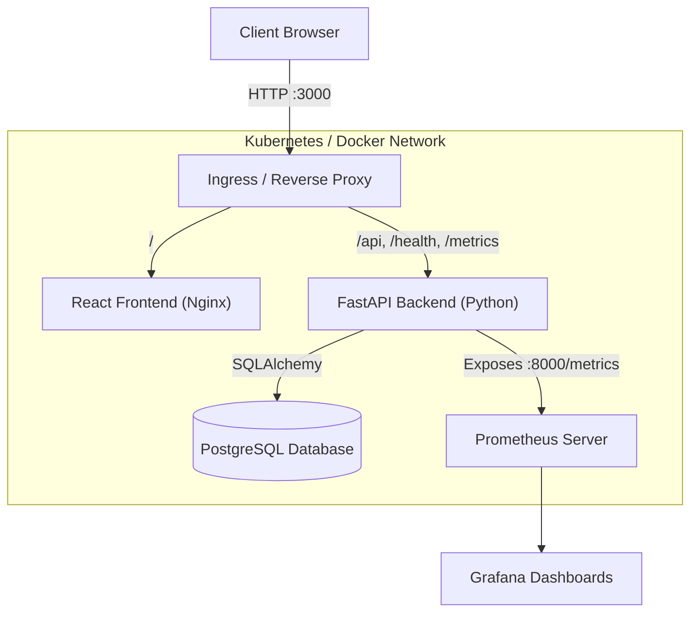

# CloudPulse

CloudPulse is an incident response and service health tracking platform built for site reliability and cloud engineering teams. It provides real-time service health checks, incident lifecycle management, and Prometheus metrics out of the box.

---

## Features

- **Incident Triage & Tracking:** Declare, investigate, resolve, and archive incidents with severity levels (`LOW`, `MEDIUM`, `HIGH`, `CRITICAL`).
- **Service Catalog Monitoring:** Monitor latency and uptime percentages across core infrastructure services.
- **Health & Readiness Probes:** Live database connectivity check via `/health`.
- **Prometheus Metrics:** Standard `/metrics` endpoint instrumented for request throughput, latency histograms, and error rates.
- **Containerized Stack:** Multi-stage, unprivileged non-root Docker builds for frontend and backend.
- **Production-Ready Deployments:** Helm charts with Horizontal Pod Autoscaling (HPA) and Kubernetes manifests.
- **Infrastructure as Code:** Terraform configuration for an AWS VPC and managed EKS cluster.
- **Automated CI/CD:** GitHub Actions pipeline with unit tests, Trivy vulnerability scanning, and Docker builds.

---

## Architecture



---

## Tech Stack

- **Backend:** FastAPI, Python 3.11, SQLAlchemy, Pydantic, Alembic, Uvicorn
- **Frontend:** React 18, Vite, Vanilla CSS
- **Database:** PostgreSQL 16
- **Testing:** Pytest, FastAPI TestClient
- **Containers & Orchestration:** Docker, Docker Compose, Kubernetes, Helm
- **Infrastructure as Code:** Terraform (AWS VPC, Subnets, EKS)
- **CI/CD & Security:** GitHub Actions, Trivy
- **Observability:** Prometheus, Grafana

---

## Quickstart (Local Docker Compose)

The easiest way to run the full stack locally is with Docker Compose:

```bash
git clone https://github.com/ponnaganti24bcs10350-svg/devops-proj.git
cd devops-proj

docker compose up -d --build

docker compose ps
```

Once running, access the services:
- **Web UI:** http://localhost:3000
- **API Documentation (Swagger):** http://localhost:8000/docs
- **Health Check:** http://localhost:8000/health
- **Prometheus Metrics:** http://localhost:8000/metrics

To shut down:
```bash
docker compose down
```

---

## Running Tests

Automated tests run against an isolated in-memory SQLite database so your local database is untouched:

```bash
python3 -m venv .venv
source .venv/bin/activate
pip install -r backend/requirements.txt

PYTHONPATH=. pytest backend/tests -v
```

---

## API Reference

| Method | Endpoint | Description |
|---|---|---|
| `GET` | `/health` | Service and database health check |
| `GET` | `/metrics` | Prometheus observability metrics |
| `GET` | `/api/v1/incidents` | List incidents (supports `?status=` and `?severity=` filters) |
| `POST` | `/api/v1/incidents` | Create a new incident |
| `GET` | `/api/v1/incidents/{id}` | Get incident details |
| `PUT` | `/api/v1/incidents/{id}` | Update incident status or details |
| `DELETE` | `/api/v1/incidents/{id}` | Delete / archive an incident |
| `GET` | `/api/v1/services` | Service catalog and uptime status |
| `GET` | `/api/v1/stats` | Summary statistics of active incidents |

---

## Kubernetes & Helm

Deploy the stack to a local or remote Kubernetes cluster (e.g. Minikube or Kind):

```bash
kubectl apply -f k8s/namespace.yaml

helm upgrade --install cloudpulse ./helm --namespace cloudpulse

kubectl get pods -n cloudpulse
```

---

## Terraform (AWS Infrastructure)

Terraform configurations for provisioning an AWS VPC and EKS cluster reside in `terraform/`:

```bash
cd terraform

terraform init

terraform validate

terraform plan -var-file=terraform.tfvars.example
```

---

## CI/CD Pipeline

The `.github/workflows/ci-cd.yml` workflow runs automatically on every push to `main`:
1. **Test:** Runs Pytest test suite with code quality checks.
2. **Build:** Runs frontend compilation (`npm run build`).
3. **Security:** Runs Trivy vulnerability scanner to flag high/critical CVEs in container images.
4. **Publish:** Builds and tags Docker images for deployment.


