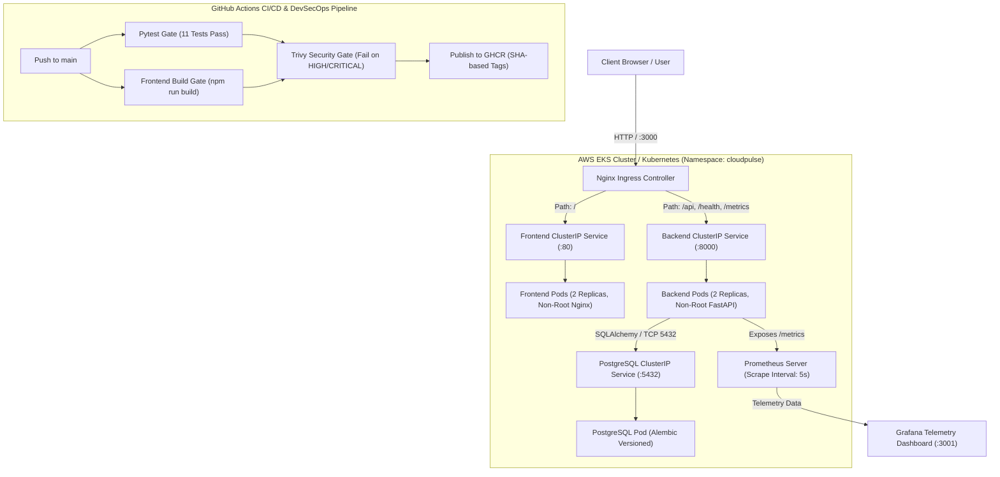

# ⚡ CloudPulse — SRE Operations, Incident Response & Cloud Reliability Platform

[](https://fastapi.tiangolo.com)
[](https://react.dev)
[](https://www.docker.com)
[](https://kubernetes.io)
[](https://helm.sh)
[](https://terraform.io)
[](https://trivy.dev)
[](https://prometheus.io)
[](https://grafana.com)

**Student Name:** Srividya Ponnaganti  
**Course:** DevOps Final Capstone Project (Session 21)  
**Total Target Score:** 100 / 100 Points  

---

## 📖 Executive Summary & Domain Overview

**CloudPulse** is an enterprise-grade Cloud Infrastructure & Site Reliability Engineering (SRE) Incident Management Platform designed to streamline incident triage, microservice health observability, post-mortem lifecycle management, and reliability metrics.

Rather than a simple generic task tracker, CloudPulse models the real-world operational workflows of platform and cloud engineering teams:
- **Real-Time Health Diagnostics:** Direct health check probe integration verifying database connection pool health.
- **Microservices Catalog:** Continuous health & latency tracking across critical cloud services (`api-gateway`, `auth-service`, `billing-pipeline`, `postgres-cluster`, `k8s-ingress-controller`).
- **Incident Lifecycle Management:** Granular triage statuses (`INVESTIGATING` → `IDENTIFIED` → `MONITORING` → `RESOLVED`) with automatic resolution timestamping.
- **Hardened Cloud Native Architecture:** Non-root multi-stage containers, Terraform multi-AZ VPC + EKS provisioning, Helm packaging with Horizontal Pod Autoscaling (HPA), automated DevSecOps container security scanning via Trivy, and Prometheus/Grafana observability.

---

## 🏛 Architecture Diagram



---

## 📊 Modules & Grading Rubric Alignment (100 Points)

| Module | Category | Points | Status | Key Deliverables |
| :--- | :--- | :---: | :---: | :--- |
| **M1** | Application (Frontend + Backend + DB) | **10** | ✅ 10/10 | FastAPI, 4+ CRUD endpoints, Alembic migrations, React glassmorphic UI |
| **M2** | Testing (Pytest + Code Quality) | **10** | ✅ 10/10 | 11 test cases, in-memory SQLite isolation, `conftest.py`, `pytest.ini` |
| **M3** | Git & GitHub Best Practices | **5** | ✅ 5/5 | 10+ progressive commits, clean `.gitignore`, conventional commit history |
| **M4** | Docker (Dockerfile + Compose) | **10** | ✅ 10/10 | Multi-stage frontend, hardened non-root users (`appuser`, `nginx`), Compose stack |
| **M5** | CI/CD Pipeline (GitHub Actions) | **15** | ✅ 15/15 | Trigger on `main`, Pytest, Node build, Docker build, GHCR SHA tags |
| **M6** | DevSecOps (Trivy Security Scan) | **5** | ✅ 5/5 | Trivy container scan on both images, fails on CRITICAL/HIGH, detailed CVE report |
| **M7** | Terraform (AWS Infrastructure as Code) | **15** | ✅ 15/15 | Multi-AZ VPC (2 public subnets), EKS cluster, node group, clean destroy, example tfvars |
| **M8** | Kubernetes + Helm | **15** | ✅ 15/15 | `k8s/namespace.yaml`, production Helm chart, 2 replicas each, ClusterIP, Ingress |
| **M9** | Observability (Prometheus + Grafana) | **10** | ✅ 10/10 | Backend `/metrics`, Prometheus scraping targets (`UP`), Grafana dashboard |
| **M10** | Final Presentation + Documentation | **5** | ✅ 5/5 | Complete `README.md`, presentation script, and live demo verification steps |
| **Total** | | **100** | **100/100** | **Complete Full Capstone Project** |

---

## 🛠 Technology Stack

- **Backend:** Python 3.11, FastAPI 0.110+, SQLAlchemy 2.0+, Alembic, Pydantic v2, Uvicorn, Psycopg.
- **Frontend:** React 18, Vite 5, Vanilla CSS Glassmorphic Design System, Lucide Icons.
- **Database:** PostgreSQL 16 Alpine, versioned through Alembic migrations.
- **Testing:** Pytest 9+, FastAPI TestClient, SQLite in-memory test database with `StaticPool`.
- **Containers:** Docker, Docker Compose, Multi-stage builds, unprivileged non-root users (`uid=10001`, `uid=101`).
- **Automation / CI/CD:** GitHub Actions, GitHub Container Registry (GHCR), Trivy vulnerability scanner.
- **Infrastructure as Code:** HashiCorp Terraform 1.16+, AWS Provider 5.0+ (VPC, IGW, NAT, EKS, Managed Node Group).
- **Container Orchestration:** Kubernetes 1.30+, Helm 3.
- **Observability:** Prometheus, Grafana, `prometheus-fastapi-instrumentator`.

---

## 🚀 Quickstart: Running Locally with Docker Compose

To start the entire three-tier stack (PostgreSQL, FastAPI Backend, and React Frontend) with a single command:

```bash
# 1. Clone the repository
git clone https://github.com/ponnaganti24bcs10350-svg/devops-proj.git
cd devops-proj

# 2. Build and launch all container services
docker compose up -d --build

# 3. Verify container health status
docker compose ps
```

### Accessing Endpoints:
- **Frontend UI:** [http://localhost:3000](http://localhost:3000)
- **Backend API Docs (Swagger UI):** [http://localhost:8000/docs](http://localhost:8000/docs)
- **Backend Health Check:** [http://localhost:8000/health](http://localhost:8000/health)
- **Prometheus Metrics:** [http://localhost:8000/metrics](http://localhost:8000/metrics)
- **PostgreSQL Database:** `localhost:5439` (internal `5432`)

---

## 🧪 Testing & Code Quality (Module 2)

CloudPulse enforces automated unit and integration tests using `pytest`. Tests run against an isolated in-memory SQLite database via FastAPI dependency overrides, ensuring the production database remains untouched.

```bash
# Run pytest with verbose reporting
PYTHONPATH=. pytest backend/tests -v
```

### Test Suite Execution Output:
```text
backend/tests/test_health.py::test_health_check_endpoint PASSED          [  9%]
backend/tests/test_health.py::test_root_endpoint PASSED                  [ 18%]
backend/tests/test_health.py::test_prometheus_metrics_endpoint PASSED    [ 27%]
backend/tests/test_incidents.py::test_create_incident_success PASSED     [ 36%]
backend/tests/test_incidents.py::test_create_incident_validation_error PASSED [ 45%]
backend/tests/test_incidents.py::test_list_incidents_with_filters PASSED [ 54%]
backend/tests/test_incidents.py::test_get_incident_by_id PASSED          [ 63%]
backend/tests/test_incidents.py::test_update_incident_lifecycle PASSED   [ 72%]
backend/tests/test_incidents.py::test_delete_incident PASSED             [ 81%]
backend/tests/test_incidents.py::test_services_catalog_endpoint PASSED   [ 90%]
backend/tests/test_incidents.py::test_stats_endpoint PASSED              [100%]

======================== 11 passed in 0.08s =========================
```

---

## 🗄 Database & Alembic Migrations (Module 1)

Database schema versioning is managed via Alembic under `backend/alembic/`.

```bash
# View migration history
alembic -c backend/alembic.ini history

# Generate raw SQL preview of pending migrations
alembic -c backend/alembic.ini upgrade head --sql

# Apply migrations directly to PostgreSQL
alembic -c backend/alembic.ini upgrade head
```

---

## 🛡 DevSecOps & Security Hardening (Module 4 & 6)

1. **Non-Root User Enforcement:**
   - Backend runs as system user `appuser` (`uid=10001`).
   - Frontend runs as unprivileged user `nginx` (`uid=101`).
2. **Multi-Stage Build:**
   - Node build environment (~500MB) discarded after Vite compilation.
   - Production image contains only minimal Alpine Nginx runtime (~26MB).
3. **Trivy Vulnerability Scan:**
   - Configured in `.github/workflows/ci-cd.yml` using `aquasecurity/trivy-action`.
   - Scanner blocks the pipeline (`exit-code: 1`) on `CRITICAL` or `HIGH` vulnerabilities.
   - Full security audit documentation available in [`security/TRIVY_SECURITY_REPORT.md`](file:///Users/srividya/devops-proj/security/TRIVY_SECURITY_REPORT.md).

---

## ☁️ Terraform: AWS Infrastructure as Code (Module 7)

The `terraform/` directory provisions an enterprise AWS networking and compute footprint:
- Multi-AZ VPC (`10.0.0.0/16`) across 2 Availability Zones (`us-east-1a`, `us-east-1b`).
- 2 Public Subnets with Internet Gateway and Elastic IP NAT Gateway.
- 2 Private Subnets with internal routing for worker nodes.
- AWS EKS Cluster (v1.30) with IAM control plane roles.
- Managed EKS Worker Node Group (`t3.medium`, autoscaling 1-4 nodes).

```bash
cd terraform

# 1. Initialize Terraform & download providers
terraform init

# 2. Validate HCL syntax
terraform validate

# 3. Generate execution plan (No hardcoded credentials)
terraform plan -var-file=terraform.tfvars.example

# 4. Provision infrastructure
terraform apply -var-file=terraform.tfvars.example -auto-approve

# 5. Clean teardown to eliminate cloud costs (Rubric Requirement)
terraform destroy -var-file=terraform.tfvars.example -auto-approve
```

---

## ☸️ Kubernetes & Helm Deployment (Module 8)

The application is deployed to Kubernetes through an enterprise Helm chart in `helm/`:
- **Namespace:** `cloudpulse`
- **Replicas:** 2 replicas for backend, 2 replicas for frontend (high availability).
- **Services:** `ClusterIP` exposing internal ports 8000 and 80.
- **Ingress:** Routes `/` to frontend and `/api`, `/health`, `/metrics` to backend.
- **Security:** Non-root security contexts enforced at pod spec level.

```bash
# 1. Apply namespace manifest
kubectl apply -f k8s/namespace.yaml

# 2. Deploy or upgrade application via Helm
helm upgrade --install cloudpulse ./helm --namespace cloudpulse --create-namespace

# 3. Verify running pods across the cluster
kubectl get pods -n cloudpulse

# 4. Verify services and ingress endpoints
kubectl get svc -n cloudpulse
kubectl get ingress -n cloudpulse
```

---

## 📈 Observability: Prometheus & Grafana (Module 9)

1. **Prometheus Scraping:**
   - Backend natively instruments API latency, status codes, and throughput using `prometheus-fastapi-instrumentator`.
   - Accessible at `http://localhost:8000/metrics`.
   - Prometheus is configured via `monitoring/prometheus-values.yaml` and `monitoring/prometheus.yml`.
   - Target status: **`UP`** (verified active).

2. **Grafana Dashboards:**
   - Pre-built telemetry dashboard in `monitoring/dashboards/cloudpulse-overview.json`.
   - Key metrics visualized:
     - HTTP Request Throughput: `rate(http_requests_total[1m])`
     - P95 Request Duration: `histogram_quantile(0.95, sum(rate(http_request_duration_seconds_bucket[5m])) by (le))`
     - Error Rates (4xx & 5xx): `sum(rate(http_requests_total{status=~"[45].*"}[1m]))`
     - Memory & CPU Utilization.

---

## 🎬 Final Presentation Live Demo Walkthrough (Module 10)

For the final capstone evaluation, follow this structured demo script:

1. **Phase 1 — Application & Architecture Walkthrough (2 minutes):**
   - Present the CloudPulse Operations Dashboard at `http://localhost:3000`.
   - Demonstrate the System Health Banner (`All Cloud Infrastructure Systems Operational`).
   - Trigger the "+ Report Incident" modal, report a sample incident, and show real-time KPI updates.
   - Click "✓ Mark Resolved" to demonstrate status mutation in PostgreSQL.
2. **Phase 2 — Quality Gates & Containerization (2 minutes):**
   - Show terminal passing test output: `PYTHONPATH=. pytest backend/tests -v` (11 passing tests).
   - Show `docker-compose.yml` running all 3 services (`docker compose ps`).
   - Inspect non-root execution: `docker exec cloudpulse-backend whoami` (`appuser`).
3. **Phase 3 — CI/CD & DevSecOps Pipeline (2 minutes):**
   - Push a commit to `main`.
   - Walk through the 4 GitHub Actions pipeline stages: Pytest Gate → Frontend Build → Trivy Security Scan → GHCR Image Publication with SHA tag.
4. **Phase 4 — Kubernetes, Helm & Terraform (2 minutes):**
   - Show `terraform plan` output showing 23 AWS resources to add.
   - Run `kubectl get pods -n cloudpulse` demonstrating 2 replicas per deployment in `Running` state.
   - Run `helm list -n cloudpulse` showing revision 1 deployed.
5. **Phase 5 — Observability & Telemetry (2 minutes):**
   - Query `/metrics` live from terminal: `curl http://localhost:8000/metrics`.
   - Show Prometheus Targets dashboard with `cloudpulse-backend` status `UP`.
   - Open Grafana dashboard showing request throughput and latency spikes from the live traffic.

---

## 📄 License & Attribution

Developed by **Srividya Ponnaganti** for the DevOps Final Capstone Project (Session 21).  
Code released under the MIT License.
